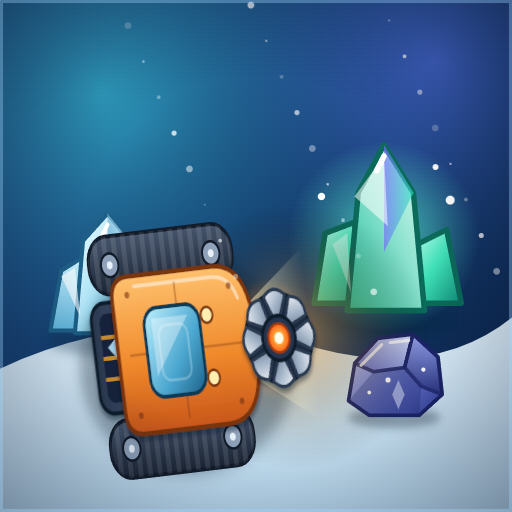
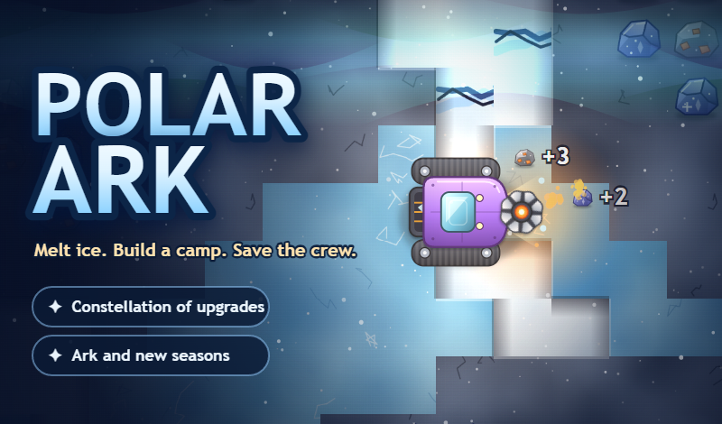
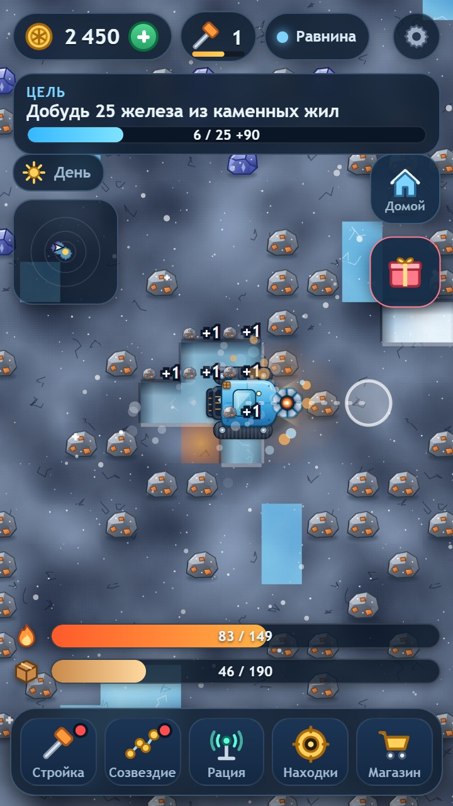
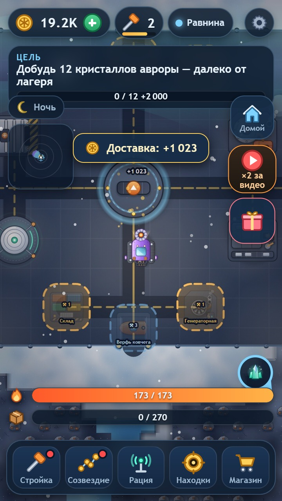
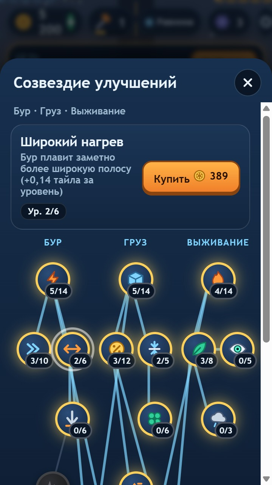
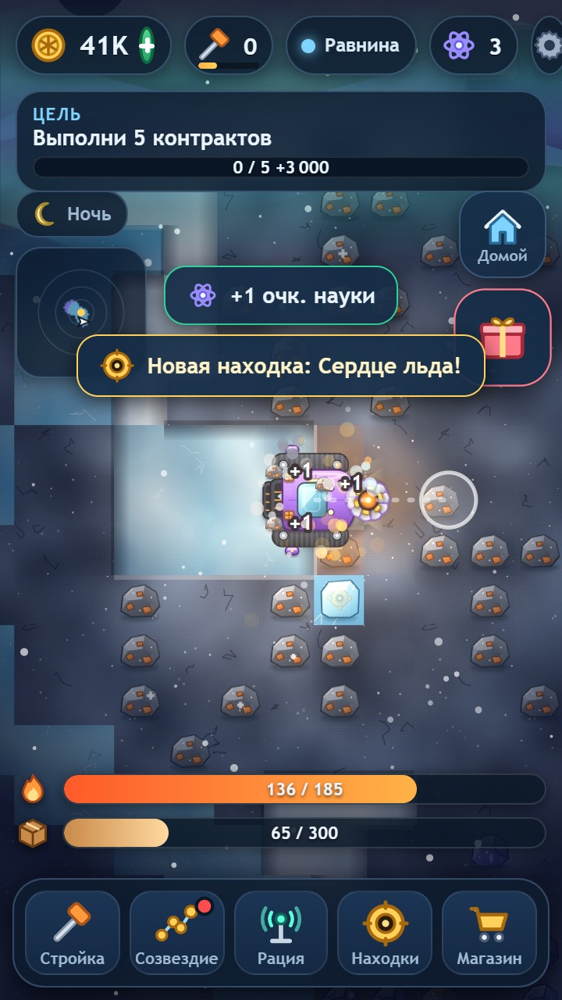
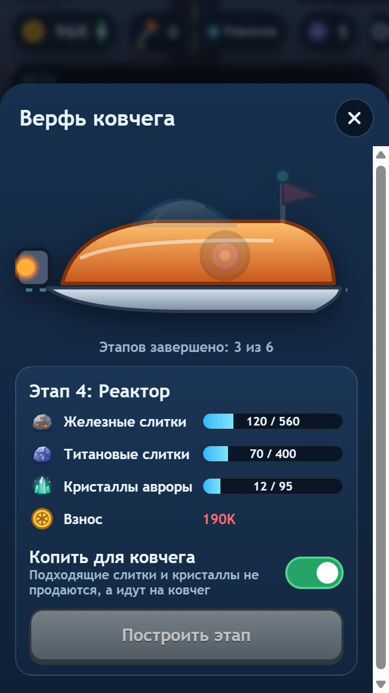

<div align="center">



# POLAR ARK

**Melt ice. Build a camp. Save the crew.**

A top-down idle/mining game for the browser, made with plain HTML5 Canvas and JavaScript, with no engine and no external assets.

**[▶ Play in your browser](https://neverweakness.github.io/polar-ark/)** · [Русская версия ниже](#-polar-ark-по-русски)



</div>

---

## About the game

You drive a thermal-drill rover across a frozen procedural world, melt ice and ore, haul the cargo to your camp and turn it into coins. Coins pay for ten buildings, a 17-node upgrade tree ("Constellation") and finally the Ark. Sail away, start a new season and keep a legacy bonus.

- **Procedural world**: 300×300 tiles, 4 zones (Plains, Rocky ridges, Ice canyons, Heart of Ice); harder rock and colder weather farther from camp, but richer veins.
- **Progression**: 10 buildings, 17 upgrades in three branches (Drill / Cargo / Survival) plus 3 cross-branch nodes, 24 goals, daily rewards, contracts, relic finds, patrol drones that earn while you are away.
- **Prestige loop**: build the Ark in 6 stages, sail away, choose next-season conditions (early night, storms, frost, rich veins).
- **Touch and mouse controls**: the rover follows your finger or cursor (WASD works too).
- **Russian and English** interface.
- **Small**: the whole build is about 260 KB. Graphics are drawn with SVG and Canvas in code, music and sounds are synthesized with the Web Audio API. There are no image, audio or video files in the game build.

## Screenshots

<p align="center">
    
</p>

## Tech stack

| Area | What is used |
|---|---|
| Language | JavaScript (ES2020), HTML5, CSS3 |
| Rendering | HTML5 Canvas 2D (world and effects), SVG generated in code (icons, buildings, vehicle) |
| Audio | Web Audio API: all sounds and music are synthesized at runtime |
| Architecture | Game core without DOM (`src/js/core.js`, `data.js`) that also runs in Node.js; separate render, UI, i18n and art modules; thin platform layer |
| Platforms | Yandex Games SDK (rewarded and interstitial ads, in-app purchases, cloud saves) and VK Bridge (VK Mini Apps, VK Storage, banner ads) |
| Frameworks | none: no game engine and no UI framework, on purpose |
| Tooling | Python 3 (`tools/build.py` builds the web, Yandex and VK targets, `sim_economy.py` balances the economy, `check_assets.py`), Node.js (`bot.js` headless bot plays whole seasons, `qa_core.js` randomized invariant testing) |
| Persistence | localStorage plus platform cloud (about 700 bytes per save) |

## Project structure

```
src/
  js/        data.js, core.js (no DOM), art.js, render.js, audio.js, ui.js, i18n.js,
             platform-yandex.js, platform-vk.js
  css/       style.css
docs/        plain web build, served by GitHub Pages
tools/       build.py, sim_economy.py, bot.js, qa_core.js, check_assets.py
ECONOMY.md   results of the economy simulation
screenshots/
```

## Run locally

```bash
python dev_server.py docs 8130        # then open http://127.0.0.1:8130/index.html
python tools/build.py                 # rebuild docs/ (+ build/yandex and vk/game)
node tools/bot.js 8 --seasons=3       # headless bot plays the game in accelerated time
python tools/sim_economy.py 5 3       # economy simulation over 5 worlds
node tools/qa_core.js 10              # randomized core QA with invariants
```

## About the web demo

The demo on GitHub Pages is the same game without platform SDKs: no ads and no purchases, progress is saved in your browser. The Yandex Games and VK builds add ads, purchases and cloud saves through the platform APIs.

## Author

[@neverweakness](https://github.com/neverweakness). I build browser games, bots, parsers and web projects.

© All rights reserved. The source is published for review as a portfolio piece. Please do not republish or resell the game or its assets.

---

# 🇷🇺 Polar Ark по-русски

**ПОЛЯРНЫЙ КОВЧЕГ**: идл-игра вида сверху для браузера. Вы ведёте вездеход с термобуром по замёрзшему миру, плавите лёд и руду, возите груз в лагерь, строите 10 зданий, улучшаете технику в «Созвездии» из 17 улучшений, собираете ковчег и отплываете в новый сезон с наследием.

**[▶ Играть в браузере](https://neverweakness.github.io/polar-ark/)**

**Технологии:** JavaScript, HTML5 Canvas, CSS, SVG (рисуется кодом), Web Audio (звук и музыка синтезируются кодом), Yandex Games SDK, VK Bridge. Фреймворков и игровых движков нет. Инструменты: Python (сборка, симулятор экономики), Node.js (бот-тестировщик, проверка ядра). Размер сборки около 260 КБ, в ней нет файлов картинок, звука и видео.

Игра подготовлена для Яндекс Игр и VK. Эта демо-версия работает без рекламы и покупок, прогресс сохраняется в браузере.
